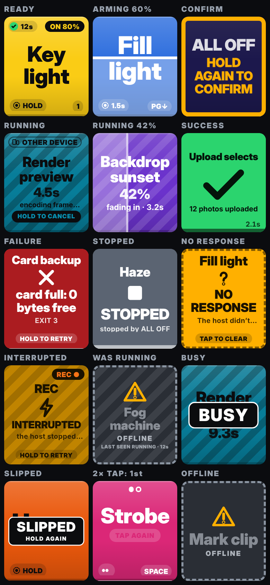

# ButtPad

A pad of a few huge buttons for moments when you can't fiddle with a screen: on a ladder setting
lights, mid-shoot, on a handlebar mount. Each button runs a preconfigured program or shell command
on a **host** (any Linux/macOS/Windows box with Bun); any phone, tablet or laptop on the LAN is a
remote via its browser. Buttons are little state machines — READY → (hold) → RUNNING → SUCCESS /
FAILURE → READY — shown with color + motion + shape so you can read them at a glance.



Status: working prototype. Spec: [docs/DESIGN.md](docs/DESIGN.md).

## Quick start

```sh
bun install
bun run example        # host with the example config: fake lights/camera scripts, 3 pads
```

It prints a **press URL** (and a QR code) and an **admin URL**. Open one on your phone (same
network). The token in the URL pairs the device and is then stripped from the address bar.

- `bun start` uses `./buttpad.config.json`, writing a harmless starter config if it's missing.
- No host handy? Open any host's page with `?demo` — an in-browser simulation of the whole thing.
- `?pad=lights` opens a pad; `?lock` hides navigation (kiosk); `?gallery` shows every button state.

Saving from the editor rewrites the config file, so `bun run example` edits
`examples/buttpad.example.json` in place — copy `examples/` somewhere if you care.

## Config

One JSON file (schema: `schema/buttpad.config.schema.json`, generated from
`src/core/config.ts`). Hand edits are picked up live; invalid edits are reported to admins and the
previous config keeps running. The admin UI's edit mode writes the same file.

```json
{
  "version": 1,
  "pads": [
    {
      "id": "lights", "name": "Lights", "cols": 2, "rows": 3,
      "buttons": [
        { "id": "key", "label": "Key light", "x": 0, "y": 0, "w": 2,
          "action": { "type": "exec", "command": "./scripts/light.sh", "args": ["key", "on"] } },
        { "id": "off", "label": "All off", "x": 0, "y": 1, "confirm": true, "key": "0",
          "action": { "type": "shell", "script": "curl -fsS http://hue.local/off && echo '@result Lights off'" } }
      ]
    }
  ]
}
```

Actions:

- `exec` runs argv directly (no shell). `shell` runs a command string with `/bin/sh -c` (`cmd /c`
  on Windows) — deliberately not `$SHELL`, so a button behaves the same from a terminal and from a
  service; set `"shell": "bash"` for bash-isms. `none` runs nothing (for stop buttons, below).
- `cwd` defaults to the config file's folder; a relative `command` resolves against `cwd`. env gets
  `BUTTPAD_PAD`, `BUTTPAD_BUTTON`, `BUTTPAD_RUN_ID` (keeps increasing across restarts), `BUTTPAD_LABEL`.
- Exit code 0 = SUCCESS. Script output protocol (stdout lines):
  `@progress 40` (determinate fill), `@status warming up`, `@result Key light ON 80%`, and
  `@state REC ●` — a device-state chip that stays on the button across runs and restarts (`@state`
  alone clears it). Without `@result`, the last stdout line is the result text (stderr's on failure).
- Background processes a script starts are left alone when it exits (ButtPad stops reading their
  output); cancelling or a timeout kills the whole process group.

Per button (defaults in parentheses):

| Field | |
|---|---|
| `x y w h` | grid cell and span (`w`,`h` = 1) |
| `label`, `color` | ≤ 200 chars; any opaque CSS color (`#2f6fde`) — avoid green/red, they read as results |
| `trigger` | `hold` (default), `tap`, `double` |
| `holdMs` (500), `driftPx` (60) | how long to hold; how far a finger may slide |
| `confirm` (false), `confirmWindowMs` (3000) | needs a second, deliberate press — enforced by the host |
| `whileRunning` | `ignore` (default), `cancel` (press again to stop; not within 700 ms of the start), `queue` (one re-run) |
| `cooldownMs` (400) | presses right after a fire are ignored on that device (key chatter, bounces) |
| `timeoutMs` (120000), `resultHoldMs` (2500) | run time limit; how long ✓/✗ shows (failures stay until touched) |
| `key` | KeyboardEvent.key (BLE remotes/clickers): fires on keydown; the visible pad wins, else the unique match on any pad |
| `stops` | `["lights/*"]`, `["camera/rec"]`, `["*"]`: running buttons to cancel before this one starts |

Other integrations: `curl -X POST -H "Authorization: Bearer $TOKEN" http://host:8787/api/press/lights/key`
(add `?confirm=1` for confirm buttons; otherwise it's refused with 428).

## Security model (read this)

- Two tokens in `buttpad.secrets.json` (0600): **press** (push buttons) and **admin** (edit the
  config — i.e. run any command on the host; treat it like an SSH key). `--rotate-tokens` revokes all.
- Browsers only ever name a pad + button; commands live in the host's config and are never sent to
  press-role devices. Press devices do see each run's one-line result text, so don't print secrets.
- Presses carry the time they were made; the host drops any older than 3 s (a press stuck in a
  dead Wi-Fi zone must never fire late). `confirm` is checked by the host, not just the UI — but it
  guards against accidents, not against a press-token holder (who can always confirm).
- Plain HTTP by default — use it on a network you trust, or `--tls-cert/--tls-key` (e.g. mkcert).
- Limits: 64 sockets (8 reserved for admin, 16 per address), press rate limits per device and
  global, 32 concurrent runs, same-origin WebSockets only.
- `buttpad.state.json` (0600, next to the config) keeps run ids, last results, `@state` chips and
  live process groups, so after a crash the host kills orphaned actions and marks them INTERRUPTED.

## In the field

- Results: ✓ shows for `resultHoldMs`; ✗ (and NO RESPONSE / NOT SENT / INTERRUPTED) stays until you
  touch it; READY buttons show how their last run went ("✓ 12 s ago").
- Menu → device settings → **Rough mode** for gloves/vibration: one button at a time, longer
  minimum tap, longer cooldown, more drift tolerance.
- `?lock&pad=lights` for a mounted tablet: no tabs, menu only on long-press; if that pad is renamed
  or deleted it says so instead of becoming another pad's remote.

## Keep-awake

The Wake Lock API needs HTTPS; on a plain-HTTP LAN page ButtPad falls back to a muted looping video
(the NoSleep trick). The menu shows which one is active. Belt and braces: set the device's
auto-lock to "never" while you work, and on iOS consider Guided Access.

## Development

```sh
bun run dev         # host with --dev (HMR, source maps) — never on an untrusted network
bun test            # host + core: unit and integration tests (real processes, real sockets)
bun run e2e         # Playwright, phone + desktop projects, demo backend and real host
bun run typecheck
bun run compile     # single-file executable in dist/buttpad (web app embedded)
```

Layout: `src/core` (the contract: config schema, protocol, state machine — what a future native
app would share), `src/server` (host), `src/web` (Preact client), `examples/` (fake device scripts
for dogfooding), `test/`, `e2e/`, `docs/` (spec, QA log, screenshots).

## Ideas not built yet

- Native iOS app (App Intents, Lock Screen / Action button) using the same config + protocol.
- A Mac menu-bar host; Shortcuts / AppleScript action types.
- Per-orientation layouts; progress from long-running background jobs; MQTT/HTTP action types.
